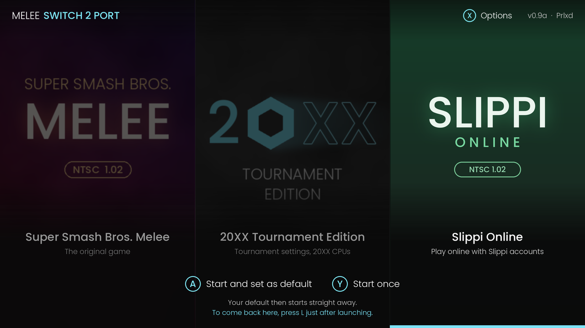

# Melee (Switch 2 Port)

Super Smash Bros. Melee running natively on Switch 2 under [kaiHEN](https://github.com/ouncebrew/kaihen), with 20XX Tournament Edition built in.
Based on [melee-unlocked](https://github.com/hero88go/melee-unlocked).



**Status: beta (v0.8.4).** Offline play only for now. Online play through Slippi is planned for a future release.

## You must supply your own game

This download contains **no game data**. You need your own copy of:

- **Super Smash Bros. Melee, NTSC-U, version 1.02**, as an `.iso` file

Other regions and versions (PAL, 1.00, 1.01) are not supported. Do not ask for the ISO here.

## Install

1. Download `melee-switch2-port.nro` from the [Releases](../../releases) page and copy it to
   `sdmc:/switch/` on your SD card.
2. Create the folder `sdmc:/melee/`.
3. Copy your Melee 1.02 NTSC ISO into it, so you have:

   ```
   sdmc:/
   ├── switch/
   │   └── melee-switch2-port.nro
   └── melee/
       └── Super Smash Bros. Melee (v1.02 NTSC).iso
   ```

4. Start it from the homebrew menu.

## First launch: "Preparing graphics"

The port comes with a list of about 2,800 shaders, recorded on a Switch 2 by playing every character on
every VS stage with every item. The first launch builds all of them before the game starts, behind a
**"Preparing graphics"** screen with a progress bar. This takes **a minute or two**, once.

Later launches show **"Loading graphics"** for about 10 seconds while the built shaders load. Matches then
run without shader stutter. A rare effect the list missed may still hitch once, the first time it appears.

The built shaders are kept on the SD card (`sdmc:/config/ouncevk/shader-cache` and
`sdmc:/melee/shader-cache`, together around 150 MB). Deleting them is safe; the next launch builds them
again. Changing the resolution (`scale`) builds them once more for the new resolution.

## Choosing a game

The first start shows a picker with two choices:

| | |
|---|---|
| **Super Smash Bros. Melee** | The original game |
| **20XX Tournament Edition** | Tournament settings and 20XX CPUs |

- **A** starts the highlighted game and makes it your default.
- **Y** starts it this once.
- **X** opens the options (rumble, tap jump, resolution, logging). Changes are saved as you make them.
- After you set a default it starts straight away. To get the picker back, **press L just after launching**.

20XX Tournament Edition needs no extra files. Its settings are in **VS Mode > Tournament Melee**.

## Controls

- **+ and - together**: quit to the homebrew menu.

## Settings

`sdmc:/melee/config.ini` is created on first start. Rumble, tap jump, resolution, logging and custom
textures can also be changed from the picker's options screen (**X**).

| Setting | Meaning |
|---|---|
| `scale` | Internal resolution. `2` (the default) holds 60 fps in 1v1 and four-player matches. `4` (sharper edges) also runs smoothly: matches, including four players, and the menus hold 60 fps; only the results screen after a match with 3 or 4 players dips, to the high 40s. `1`, `1.5` and `3` also work. |
| `rumble` | Controller rumble strength: `0` = off (default), `50` = normal, `100` = strongest. Melee's own per-player Rumble option also applies. |
| `tapjump` | `1` = stick up jumps, `0` = only X/Y jump. |
| `cpu20xx` | 20XX CPU AI. `1` = in Tournament Edition only, `2` = always, `0` = never. |
| `boot` | `ask`, `normal` or `te`. |
| `hdtextures` | Custom textures: `1` loads Dolphin-format texture packs from `sdmc:/melee/textures/` (see below). Off by default. |
| `logging` | `1` writes log files for reporting a problem. Off by default. |
| `crashtrail` | `1` also records what ran just before a crash. Slows the game; leave at `0`. |

## Custom textures

The port loads Dolphin-format texture packs: folders of PNG files named like `tex1_64x64_51c08f85e5c371b7_0.png`,
the kind made for Dolphin's `Load/Textures/GALE01` folder. No pack is included; download them from their
authors.

1. Put each pack in its own folder in `sdmc:/melee/textures/`, for example
   `sdmc:/melee/textures/Melee HD/`. If the pack's download has a `GALE01` folder, copying that folder in
   works too.
2. Turn **Custom textures** on in the options screen (**X** in the picker), or set `hdtextures=1`.

Tested with the Melee HD Texture Pack.
Packs only change how things look, so they are safe to use with any game mode.

- Menu pictures (title, character and stage select, HUD, results) are prepared while the game starts, so
  they appear at once. Other pictures (stages, effects) load the first time they are drawn and can appear a
  moment after the rest.
- A pack can need a few extra shaders the first time its pictures appear, causing a brief slowdown on the
  first visit to a screen or stage; after that they are built at startup with the rest.
- Very large pictures (over 2048 pixels a side) are halved to save memory.
- Costume and stage mods that replace `.dat` files are not supported; only texture packs.

## Known issues

- At `scale=4`, the results screen after a match with 3 or 4 players drops into the high 40s; 1v1 is unaffected. Everything else at 4x, matches included, runs at 60 fps.
- TE's input display and quieter Dream Land 64 music are not implemented.
- No online play.
- Tested in handheld and docked mode, mostly in VS mode. Single-player modes have had little testing.

## Reporting a problem

Open an issue on this GitHub repository. Logs are off by default, so collect them first:

1. In `sdmc:/melee/config.ini`, set `crashtrail=1`. This turns logging on and records what ran just
   before a crash. The game runs slower while it is on.
2. Reproduce the problem.
3. If it was a crash, **launch the port once more** so the crash trail is written into the log.
4. Attach these files from `sdmc:/melee/` to your issue:
   - `crumbs.bin` (the crash trail file)
   - `boot.log` and `boot.1.log`
   - `gl.log` and `gl.1.log`
5. Say which version you ran (shown in the top-right of the game picker), which game you picked
   (Melee or 20XX Tournament Edition), and what you were doing: characters, stage, mode.
6. Set `crashtrail=0` again afterwards to get full speed back.

For a problem that is not a crash (a visual glitch, slowdown), `logging=1` is enough and does not slow
the game; attach `boot.log` and `gl.log`.

## Credits and license

- [melee-unlocked](https://github.com/hero88go/melee-unlocked) and its contributors
- The [doldecomp/melee](https://github.com/doldecomp/melee) decompilation project
- [20XX Tournament Edition](https://github.com/dansalvato/20XXTE) by Dan Salvato and its contributors. Its features here are the rewrites from melee-unlocked; no 20XXTE save file is needed or included.
- [kaiHEN](https://github.com/ouncebrew/kaihen), libounce and OunceVK by the ouncebrew contributors
- Mesa, libnx, SDL

Licensed under GPL-3.0-or-later, the same as melee-unlocked. The port's source changes are in
[`patches/`](patches), and [BUILDING.md](BUILDING.md) explains how to build it.
See `LICENSE` and `NOTICE`.

Super Smash Bros. Melee is the property of Nintendo / HAL Laboratory. This project is not affiliated with them.

## How this port was made

Most of the Switch 2 port's code was written by Claude, Anthropic's AI model.
